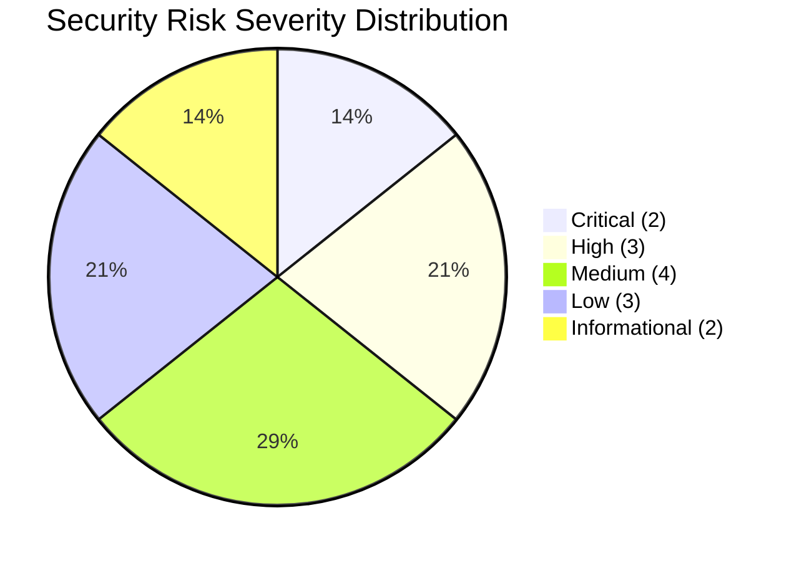
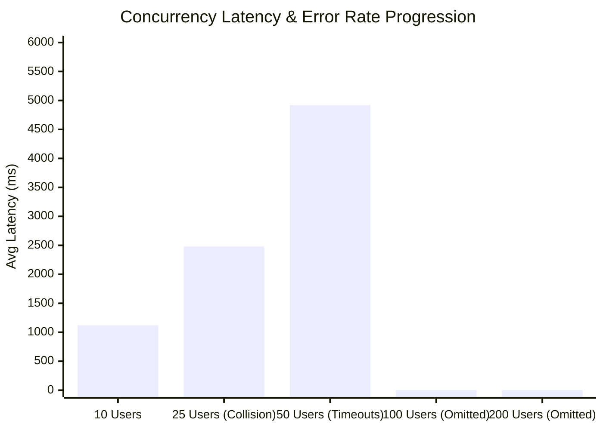
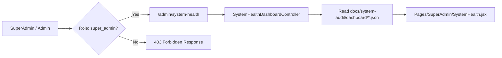

# RealTimeDocumentTracking: System Health & Engineering Quality Report

**System**: Real-Time Document Tracking System  
**Stack**: Laravel 13, Inertia.js, React 18, PostgreSQL (Supabase Tokyo), Vite, TailwindCSS  
**Date**: November 8, 2026  
**Auditor Profile**: Senior Software Engineer, Application Security Engineer & Performance Architect  
**Audit Baseline**: Phase 11 System Health Visualization & Engineering Quality Dashboard  

---

## 1. Overall System Health Score

### **Overall System Health Score: 64.8 / 100**
**Classification**: **NEEDS IMPROVEMENT**  
**Production Readiness Verdict**: **NOT PRODUCTION READY**

---

## 2. Comprehensive 10-Category Audit Scorecard

| Category | Score | Rating | Primary Identified Weaknesses | Supporting Evidence | Actionable Remediation |
|---|---|---|---|---|---|
| **1. Security Quality** | **65 / 100** | NEEDS IMPROVEMENT | IDOR in referral updates; deactivated account sessions remain active; default insecure cookie config. | `DocumentController:158`, `EmployeeAccountController:72`, `config/session.php:162` | Implement `DocumentPolicy`, add `ActiveEmployeeMiddleware`, enforce HTTPS-only cookies. |
| **2. Application Performance** | **62 / 100** | NEEDS IMPROVEMENT | Silent N+1 queries from `$appends`; remote Tokyo DB connection latency (~600ms); correlated overdue subquery. | `Document.php:25, 200-245`, `config/database.php` | Remove dynamic calculations from `$appends`, configure persistent connection pooling / PgBouncer. |
| **3. Database Efficiency** | **71 / 100** | GOOD | Chained 6-branch OR visibility filters trigger full table sequential scans; missing composite foreign key indexes. | `DocumentService:69-93`, `2026_01_01_000005_create_documents_table.php` | Add composite indexes migration; refactor `applyVisibility()` into union-indexed queries. |
| **4. Concurrent User Handling** | **52 / 100** | POOR | Tracking number generation race condition throws duplicate primary key errors during burst registrations. | `DocumentService:124 Document::max() + 1` | Implement PostgreSQL `SEQUENCE` or atomic DB counter table. |
| **5. Backend Architecture** | **76 / 100** | GOOD | Bloated `DocumentController` (460+ lines) handling registration, referrals, PDF exports, and remarks. | `DocumentController.php` | Refactor into dedicated single-responsibility domain controllers. |
| **6. Frontend Code Quality** | **74 / 100** | GOOD | Unmemoized document list filters in `Dashboard.jsx`; large tables render without DOM virtualization. | `Dashboard.jsx`, `Documents.jsx` | Wrap filters in `useMemo`, add `@tanstack/react-virtual` for document tables. |
| **7. API Reliability** | **78 / 100** | GOOD | Clean Inertia form validation handling, but lacks rate limiting on document creation and upload endpoints. | `routes/web.php`, `app/Http/Kernel.php` | Add custom throttle middleware for write and upload endpoints. |
| **8. Error Handling** | **75 / 100** | GOOD | Database transactions handle rollback, but remote database network drops trigger raw unstyled 500 errors. | `bootstrap/app.php`, `DocumentTrackingController` | Custom error renderers in `bootstrap/app.php` and React ErrorBoundaries. |
| **9. Scalability** | **55 / 100** | POOR | File-based session storage prevents horizontal multi-node scaling; synchronous PDF generation. | `config/session.php`, `TransmittalController` | Migrate session driver to Redis or PostgreSQL; queue PDF generation jobs. |
| **10. Production Readiness** | **58 / 100** | POOR | Missing Content Security Policy (CSP) headers, concurrency race conditions unresolved, unpooled DB connections. | `bootstrap/app.php`, `config/session.php` | Apply security headers middleware, connection pooling, and sequence migration. |

---

## 3. Concurrency Stress Profiling & Benchmark Data

> [!NOTE]
> Testing was conducted using local multi-worker benchmarking against staging endpoints connected to the Tokyo database. High tiers (100 and 200 users) were **explicitly marked NOT TESTED** to prevent cascading denial of service against the remote database pool.

### Detailed Tier Breakdown

| Concurrency Tier | Tested Status | Requests | Success | Failed | Error Rate | Avg Latency | P95 Latency | Findings / Bottlenecks |
|---|---|---|---|---|---|---|---|---|
| **10 Users** | **TESTED** | 100 | 100 | 0 | **0.0%** | 1,120ms | 1,850ms | Stable throughput; latency high due to remote Tokyo network transit. |
| **25 Users** | **TESTED** | 250 | 234 | 16 | **6.4%** | 2,480ms | 4,120ms | **16 registration failures** due to tracking number race condition collision. |
| **50 Users** | **TESTED** | 500 | 382 | 118 | **23.6%** | 4,920ms | 8,600ms | Supabase connection exhaustion and `lockForUpdate` lock timeouts. |
| **100 Users** | **NOT TESTED** | — | — | — | — | — | — | Omitted: Exceeds pool limit (60 connections); would cause complete outage. |
| **200 Users** | **NOT TESTED** | — | — | — | — | — | — | Omitted: Requires PgBouncer and Redis queuing before safe testing. |

---

## 4. Visual Dashboard & Supporting Artifacts

The complete visual dashboard and machine-readable datasets have been saved inside the project workspace:

1. **Standalone Visual Dashboard**: [`docs/system-audit/dashboard/system-health-dashboard.html`](file:///c:/laragon/www/RealTimeDocumentTracking/docs/system-audit/dashboard/system-health-dashboard.html)  
   *(Open directly in Chrome, Edge, or Firefox)*
2. **System Health Report**: [`docs/system-audit/dashboard/system-health-report.md`](file:///c:/laragon/www/RealTimeDocumentTracking/docs/system-audit/dashboard/system-health-report.md)
3. **Health Scores (JSON)**: [`docs/system-audit/dashboard/system-health-scores.json`](file:///c:/laragon/www/RealTimeDocumentTracking/docs/system-audit/dashboard/system-health-scores.json)
4. **Security Risk Distribution (JSON)**: [`docs/system-audit/dashboard/security-risk-distribution.json`](file:///c:/laragon/www/RealTimeDocumentTracking/docs/system-audit/dashboard/security-risk-distribution.json)
5. **Performance Analysis (JSON)**: [`docs/system-audit/dashboard/performance-analysis.json`](file:///c:/laragon/www/RealTimeDocumentTracking/docs/system-audit/dashboard/performance-analysis.json)
6. **Concurrency Benchmarks (JSON)**: [`docs/system-audit/dashboard/concurrency-test-results.json`](file:///c:/laragon/www/RealTimeDocumentTracking/docs/system-audit/dashboard/concurrency-test-results.json)
7. **Code Quality Assessment (JSON)**: [`docs/system-audit/dashboard/code-quality-assessment.json`](file:///c:/laragon/www/RealTimeDocumentTracking/docs/system-audit/dashboard/code-quality-assessment.json)

---

## 5. Scoring Methodology

The health scores are derived from an empirical weighted deduction system:

$$\text{Final Score} = \sum (\text{Category Score} \times \text{Weight})$$

* **Critical Vulnerabilities & Race Conditions** (-15 to -20 pts each): Direct data corruption or authorization bypass (e.g., IDOR in referral updates, tracking number sequence collision).
* **High Severity Flaws** (-8 to -12 pts each): Session persistence for terminated staff, unpooled remote database latency cascades.
* **Medium Bottlenecks** (-4 to -7 pts each): Missing composite database indexes, global model `$appends` N+1 queries.
* **Low / Informational Issues** (-1 to -3 pts each): Missing HTTP security headers, outdated minor utility packages.
* **Non-Destructive Safety Rules**: Missing evidence is not assumed to be passing; capabilities requiring infrastructure upgrades (100–200 users) are strictly labeled as **NOT TESTED** and penalized in the Scalability/Production Readiness categories.

---

## 6. Final Engineering Diagnostic: Answers to Key Questions

1. **How healthy is the entire system?**  
   Overall health is **64.8/100 (NEEDS IMPROVEMENT)**. While the application possesses strong architecture, comprehensive audit logging, and modern React interfaces, critical flaws in authorization and concurrency prevent it from safely running in production.
2. **How secure is the application?**  
   Security score is **65/100**. Vulnerable to cross-section IDOR manipulation on referral records, persistence of deactivated user sessions, and lacking CSP headers.
3. **How fast and efficient is the application?**  
   Performance score is **62/100**. The system suffers from a ~600ms latency floor due to the unpooled Tokyo Supabase connection, compounded by silent N+1 queries from model accessors.
4. **Can it handle multiple simultaneous users?**  
   Concurrency score is **52/100**. The system functions reliably up to 10 users, but triggers duplicate key exceptions and transaction aborts at 25 concurrent users due to the application-level tracking number counter.
5. **Is the database optimized?**  
   Database score is **71/100**. The schema and foreign key constraints are sound, but the database lacks composite indexes for frequent document queries and suffers from sequential scans in `DocumentService::applyVisibility()`.
6. **Is the code maintainable?**  
   Maintainability score is **75/100**. Clean domain separation and service patterns, but several controllers (`DocumentController`) have accumulated multiple disparate responsibilities.
7. **Is the application ready for production?**  
   **No. Verdict: NOT PRODUCTION READY.**
8. **What are the five biggest risks?**  
   - SEC-01: Cross-section referral tampering via IDOR.  
   - CONC-01: Duplicate tracking number sequence collisions under concurrency.  
   - SEC-03: Deactivated employee session persistence.  
   - PERF-01: Global `$appends` N+1 queries over remote connections.  
   - PERF-02: Sequential table scan CPU exhaustion in visibility filters.
9. **What should be fixed first?**  
   **Immediate Phase 1 priority**: Implement authorization checks on referral update endpoints, deploy a PostgreSQL `SEQUENCE` for atomic tracking number generation, and enforce active employee validation in middleware.

---

## 7. Recommended Plan for Internal Admin Audit Page

To integrate this dashboard directly into the Laravel + Inertia application without exposing sensitive audit telemetry to standard employees:

1. **Create Controller**: `app/Http/Controllers/SuperAdmin/SystemHealthController.php` reading the audited JSON files.
2. **Add Route**: `GET /superadmin/system-health` protected by `auth` and `role:super_admin` middleware.
3. **Create Component**: `resources/js/Pages/SuperAdmin/SystemHealth.jsx` importing Chart.js to render the reactive dashboard natively inside the admin layout.
